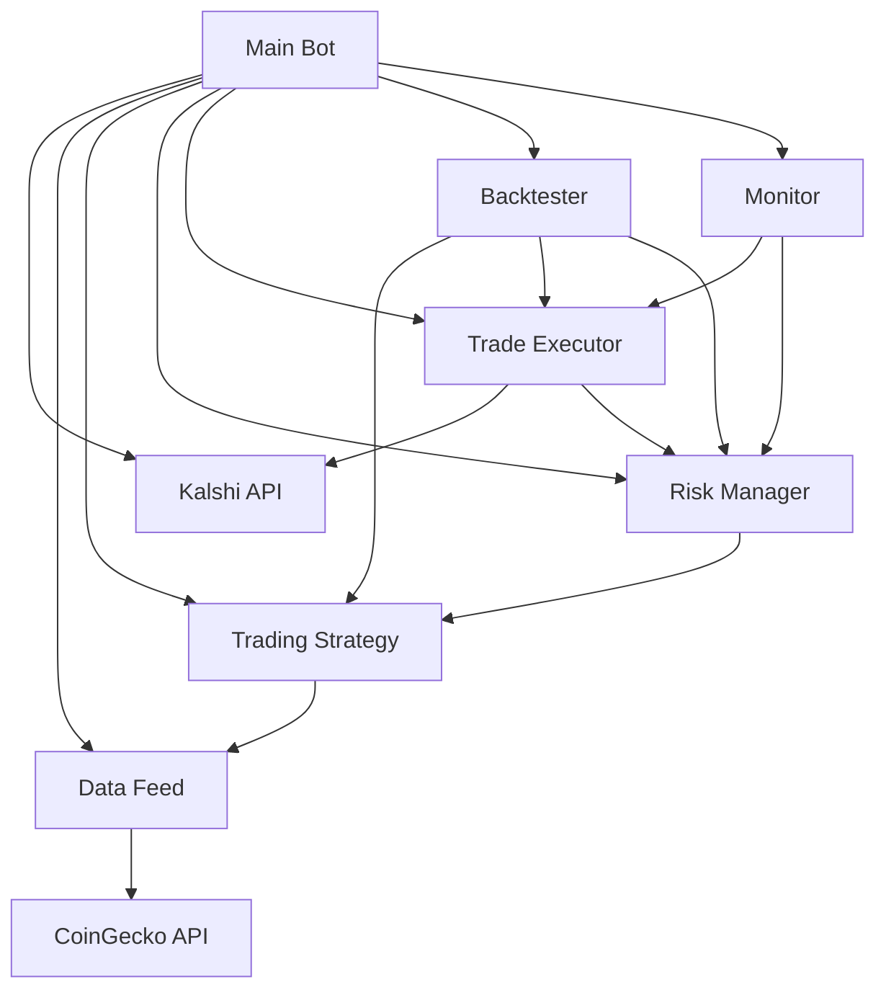

# Kalshi Bitcoin Trading Bot

A sophisticated trading bot for Kalshi markets that trades Bitcoin volatility using technical analysis and comprehensive risk management.

## Table of Contents

- [Overview](#overview)
- [Architecture](#architecture)
- [Components](#components)
  - [API Layer](#api-layer)
  - [Data Layer](#data-layer)
  - [Strategy Layer](#strategy-layer)
  - [Risk Management](#risk-management)
  - [Execution Layer](#execution-layer)
  - [Backtesting](#backtesting)
  - [Monitoring](#monitoring)
- [Installation](#installation)
- [Configuration](#configuration)
- [Usage](#usage)
- [Strategy Details](#strategy-details)
- [Risk Management](#risk-management-1)
- [Performance Metrics](#performance-metrics)
- [Future Improvements](#future-improvements)

## Overview

The Kalshi Bitcoin Trading Bot is designed to profit from Bitcoin price fluctuations on Kalshi prediction markets. It uses a volatility-based trading strategy with comprehensive risk management to ensure capital preservation while seeking profitable opportunities.

### Key Features

- **Volatility Detection**: Uses Bollinger Bands and ATR to identify high-probability trading opportunities
- **Comprehensive Risk Management**: Position sizing, daily loss limits, and drawdown protection
- **Backtesting Framework**: Test strategies on historical data before live trading
- **Real-time Monitoring**: Detailed logging and performance tracking
- **Modular Architecture**: Easy to extend or modify individual components
- **Multiple Data Sources**: Supports CoinGecko, Yahoo Finance, Binance, and CryptoCompare APIs
- **Parameter Optimization**: Built-in scripts for finding optimal strategy parameters
- **Extended Historical Data**: Up to 2 years of Bitcoin price data for robust backtesting

## Architecture



### Data Flow

1. **Data Collection**: Bitcoin price data from CoinGecko → Data Feed
2. **Signal Generation**: Data Feed → Strategy → Trading Signals
3. **Risk Assessment**: Strategy → Risk Manager → Position Sizing
4. **Trade Execution**: Risk Manager → Trade Executor → Kalshi API
5. **Monitoring**: All components → Monitor → Logs & Reports

## Components

### API Layer

**File**: `api/kalshi_api.py`

The Kalshi API wrapper handles all communication with Kalshi's trading API:

- **Authentication**: HMAC signature generation for secure API calls
- **Rate Limiting**: Automatic request throttling to avoid API limits
- **Endpoints**: 
  - Market data retrieval
  - Order placement and cancellation
  - Position management
  - Account balance queries

**Key Methods**:
- `get_markets()`: Retrieve available trading markets
- `get_orderbook(market_id)`: Get current order book
- `place_order()`: Execute trades
- `cancel_order()`: Cancel pending orders

### Data Layer

**File**: `data/data_feed.py`

Manages Bitcoin price data from multiple sources:

- **Data Sources**: CoinGecko API (primary), with extensibility for others
- **Historical Data**: CSV storage for backtesting and analysis
- **Real-time Updates**: Configurable update intervals
- **Volatility Calculation**: Built-in volatility metrics

**Key Features**:
- Automatic data refresh with configurable intervals
- Historical data persistence
- Volatility calculation for strategy inputs
- Error handling and fallback mechanisms

### Strategy Layer

**File**: `strategies/bitcoin_strategy.py`

Implements the core trading logic using technical analysis:

**Strategy**: Volatility Breakout with Mean Reversion

**Indicators Used**:
- **Bollinger Bands**: Identify overbought/oversold conditions
- **ATR (Average True Range)**: Measure volatility
- **Historical Volatility**: Filter low-volatility periods

**Signal Generation**:
1. **Buy Signals**: When price breaks above upper Bollinger Band with sufficient volatility
2. **Sell Signals**: When price breaks below lower Bollinger Band with sufficient volatility
3. **Mean Reversion**: When price returns to middle band after extreme moves

**Confidence Scoring**: Signals include confidence levels based on volatility magnitude

### Risk Management

**File**: `risk/risk_manager.py`

Comprehensive risk control system:

**Risk Parameters**:
- `max_position_size`: Maximum capital allocation per trade (default: 2%)
- `max_daily_loss`: Maximum daily loss limit (default: 5%)
- `stop_loss_pct`: Per-trade stop loss (default: 3%)
- `max_drawdown`: Maximum account drawdown (default: 10%)
- `position_limit`: Maximum contract size

**Key Features**:
- **Dynamic Position Sizing**: Adjusts based on signal confidence
- **Daily Loss Tracking**: Resets at midnight
- **Drawdown Monitoring**: Prevents catastrophic losses
- **Automatic Shutdown**: Stops trading when limits are reached

### Execution Layer

**File**: `execution/trade_executor.py`

Handles order execution and position management:

**Capabilities**:
- Order placement with proper price discovery
- Order cancellation and management
- Position closing and liquidation
- Trade result tracking

**Execution Logic**:
1. Receives trading signals from strategy
2. Calculates position size with risk manager
3. Determines execution price from order book
4. Places orders via Kalshi API
5. Tracks active orders and positions

### Backtesting

**File**: `backtesting/backtester.py`

Comprehensive backtesting framework:

**Features**:
- Historical data replay
- Simulated trade execution with slippage
- Performance metrics calculation
- Strategy optimization

**Metrics Calculated**:
- Total trades, winning/losing trades
- Win rate and profit factor
- Total return and Sharpe ratio
- Maximum drawdown
- Average profit/loss per trade

**Optimization**: Grid search for parameter tuning

### Monitoring

**File**: `monitoring/monitor.py`

Comprehensive logging and reporting:

**Logging**:
- Trade execution logs (CSV format)
- Performance metrics (CSV format)
- Error logging
- Backtest results

**Reporting**:
- Real-time performance dashboards
- Historical trade analysis
- Risk metric tracking
- Comprehensive error reporting

## Installation

### Prerequisites

- Python 3.9+
- pip package manager
- Kalshi API account
- CoinGecko API key (optional but recommended)

### Setup

```bash
# Clone the repository (or use this directory)
git clone https://github.com/your-repo/kalshi-bot.git
cd kalshi-bot

# Install dependencies
pip install -r requirements.txt

# Create data directory
mkdir -p data logs
```

## Configuration

Edit `config.json` to set up your trading parameters:

```json
{
    "api": {
        "base_url": "https://api.kalshi.co/v1",
        "api_key": "your_kalshi_api_key",
        "api_secret": "your_kalshi_api_secret",
        "timeout": 30,
        "rate_limit": 10
    },
    "data": {
        "bitcoin_source": "coingecko",
        "coingecko_api_key": "your_coingecko_api_key",
        "historical_data_file": "data/bitcoin_historical.csv",
        "update_interval": 60,
        "lookback_period": "7d"
    },
    "strategy": {
        "name": "volatility_breakout",
        "parameters": {
            "bb_period": 20,
            "bb_std_dev": 2.0,
            "atr_period": 14,
            "min_volatility": 0.015,
            "max_spread": 0.05
        }
    },
    "risk": {
        "max_position_size": 0.02,
        "max_daily_loss": 0.05,
        "stop_loss_pct": 0.03,
        "max_drawdown": 0.10,
        "position_limit": 1000,
        "initial_capital": 10000.0
    },
    "trading_interval": 60
}
```

## Usage

### Data Fetching Scripts

The bot includes several scripts for fetching historical data:

```bash
# Fetch data from CoinGecko (365 days, free tier)
python fetch_data.py

# Fetch data from Yahoo Finance (2 years, recommended)
python fetch_yahoo_data.py

# Try alternative data sources (Binance, CryptoCompare)
python fetch_alternative_data.py

# Fetch extended data with multiple API calls
python fetch_extended_data.py
```

### Running Backtests

```python
# In main.py, uncomment the backtest line:
bot.run_backtest("2023-01-01", "2023-12-31")

# Or use the Yahoo Finance data range:
bot.run_backtest("2024-06-01", "2026-03-19")
```

### Running Live Trading

```bash
python main.py
```

### Strategy Optimization

The bot includes optimization scripts to find profitable parameters:

```bash
# Simple parameter testing (quick test of aggressive parameters)
python simple_optimize.py

# Comprehensive parameter optimization (grid search)
python optimize_strategy.py
```

Example optimization parameter grid:

```python
# Example optimization parameter grid
param_grid = {
    'bb_period': [15, 20, 25],
    'bb_std_dev': [1.5, 2.0, 2.5],
    'atr_period': [10, 14, 20],
    'min_volatility': [0.01, 0.015, 0.02]
}

results = bot.backtester.optimize_strategy("2023-01-01", "2023-06-30", param_grid)
```

Optimization results are saved to `optimization_results.json` and `working_parameters.json`.

## Strategy Details

### Volatility Breakout Strategy

**Core Concept**: Profit from Bitcoin's tendency to continue moving in the direction of volatility breakouts.

**Entry Conditions**:
1. **Long (Buy)**: Price closes above upper Bollinger Band AND volatility > minimum threshold
2. **Short (Sell)**: Price closes below lower Bollinger Band AND volatility > minimum threshold
3. **Mean Reversion**: Price returns to middle band after extreme move

**Exit Conditions**:
- Take profit: Fixed percentage or trailing stop
- Stop loss: 3% from entry (configurable)
- Time-based: End of trading session

**Indicators**:
- **Bollinger Bands (20, 2)**: Measures price relative to moving average
- **ATR (14)**: Measures volatility for position sizing
- **Historical Volatility**: Filters low-volatility periods

### Strategy Parameters

| Parameter | Default | Description |
|-----------|---------|-------------|
| `bb_period` | 20 | Bollinger Bands lookback period |
| `bb_std_dev` | 2.0 | Standard deviations for bands |
| `atr_period` | 14 | ATR calculation period |
| `min_volatility` | 0.015 | Minimum volatility threshold |
| `max_spread` | 0.05 | Maximum bid-ask spread |

## Risk Management

### Position Sizing

```python
position_size = (account_capital * max_position_size) * signal_confidence
```

### Risk Limits

1. **Position Size Limit**: 2% of capital per trade (configurable)
2. **Daily Loss Limit**: 5% of starting daily capital
3. **Maximum Drawdown**: 10% from peak capital
4. **Stop Loss**: 3% per trade
5. **Position Limit**: 1000 contracts maximum

### Risk Monitoring

- Real-time drawdown calculation
- Automatic trading halt when limits reached
- Daily limit reset at midnight
- Comprehensive logging of all risk events

## Performance Metrics

### Backtest Metrics

- **Total Return**: Overall profitability
- **Sharpe Ratio**: Risk-adjusted returns
- **Win Rate**: Percentage of winning trades
- **Profit Factor**: Gross wins / Gross losses
- **Max Drawdown**: Worst peak-to-trough decline
- **Average Profit/Loss**: Per-trade performance

### Live Trading Metrics

- Real-time P&L tracking
- Drawdown monitoring
- Position exposure
- Order execution quality
- Slippage analysis

## Future Improvements

### Planned Enhancements

1. **Additional Strategies**:
   - Machine learning-based prediction
   - Arbitrage between markets
   - News sentiment analysis

2. **Advanced Features**:
   - Portfolio optimization
   - Multi-market correlation analysis
   - Dynamic position sizing algorithms

3. **Infrastructure**:
   - Docker containerization
   - Cloud deployment options
   - Web-based dashboard

4. **Risk Management**:
   - Volatility-targeted position sizing
   - Correlation-based risk limits
   - Monte Carlo simulation for risk assessment

### Technical Debt

- Implement proper order status checking
- Add more sophisticated error recovery
- Enhance backtesting with more realistic slippage models
- Add database support for larger datasets

## Contributing

Contributions are welcome! Please follow these guidelines:

1. Fork the repository
2. Create a feature branch
3. Implement your changes
4. Add tests for new functionality
5. Submit a pull request

## Files

### Main Files

```
📁 kalshi_bot/
├── 📁 api/                  # API connections
├── 📁 backtesting/         # Backtesting framework
├── 📁 data/                # Data feeding and processing
├── 📁 execution/           # Trade execution
├── 📁 monitoring/          # Performance monitoring
├── 📁 risk/                # Risk management
├── 📁 strategies/          # Trading strategies
├── 📁 tests/               # Test cases
├── config.json            # Main configuration
├── main.py                # Main entry point
├── requirements.txt       # Dependencies
└── README.md             # Documentation
```

### New Scripts Added

**Data Fetching Scripts:**
- `fetch_data.py` - CoinGecko API data fetcher (365 days)
- `fetch_yahoo_data.py` - Yahoo Finance data fetcher (2+ years, recommended)
- `fetch_alternative_data.py` - Alternative API data sources (Binance, CryptoCompare)
- `fetch_extended_data.py` - Extended data fetching with multiple API calls

**Optimization Scripts:**
- `simple_optimize.py` - Quick parameter testing with aggressive settings
- `optimize_strategy.py` - Comprehensive grid search optimization

**Configuration Files:**
- `config_yahoo.json` - Configuration for Yahoo Finance data source
- `config_extended.json` - Configuration for extended datasets

## License

[MIT License](LICENSE)

## Disclaimer

This software is for educational purposes only. Trading involves significant risk and can result in substantial financial losses. The authors are not responsible for any trading decisions made using this software. Always conduct thorough testing and use proper risk management.

## Support

For issues or questions, please open a GitHub issue or contact the maintainers.
